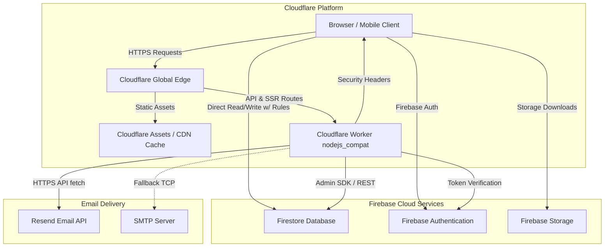

# EduNova Technical & Deployment Audit Report

**Target Platform:** Cloudflare Workers (Full-Stack Next.js 16)  
**Date:** October 2026  
**Auditor:** Senior Full-Stack & Application Security Engineer  

---

## 1. Executive Summary

This comprehensive audit investigated the EduNova codebase across its architecture, dependencies, security boundaries, runtime compatibility, and deployment readiness for Cloudflare Workers.

Before remediation, the application contained **Critical** security bypasses (including an unrestricted Firestore authorization bypass in `contact_messages` and client-side mutable order payment statuses), **High** runtime-incompatible filesystem operations (`contact_messages.json`), unauthenticated admin API endpoints, and unbounded download payloads.

All identified vulnerabilities have been systematically corrected, filesystem persistence has been eliminated in favor of managed Firestore persistence, APIs have been hardened with token-based server authorization, and Cloudflare configuration (`wrangler.jsonc`, `open-next.config.ts`, security headers) has been established.

---

## 2. Findings Ranked by Severity

### Critical Severity

| Finding ID | Component | Description | Status |
| :--- | :--- | :--- | :--- |
| **SEC-CRIT-01** | `firestore.rules` | **Unconditional Authorization Bypass (`\|\| true`):** The `contact_messages` collection rule previously contained `allow read, update, delete: if isAnyAdmin() \|\| true;`, allowing unauthenticated public internet users to read all inquiries (names, emails, phones) and wipe or tamper with any message. | **RESOLVED:** Unconditional bypass removed; read/update/delete strictly limited to verified `isAnyAdmin()`. |
| **SEC-CRIT-02** | `firestore.rules` & `orders.ts` | **Client-Controlled Order Status Tampering:** `match /orders/{orderId}` permitted authenticated users to update their own order document without restricting affected keys. A customer could directly update `status: "approved"` and `deliveryStatus: "delivered"`, bypassing payment verification. | **RESOLVED:** Added key diff checks; only administrators can alter `status`, `deliveryStatus`, `amount`, `utrNumber`, or `invoiceId`. |
| **SEC-CRIT-03** | `src/app/api/contact` | **Unauthenticated Administrative Data & Mutation Endpoints:** `GET /api/contact`, `PATCH /api/contact`, and `DELETE /api/contact` had zero server-side authentication. Any visitor could dump all customer messages or delete all records with `?id=all`. | **RESOLVED:** Implemented `verifyServerRequest(request, true)` requiring valid Firebase ID tokens and verified administrative status. |

---

### High Severity

| Finding ID | Component | Description | Status |
| :--- | :--- | :--- | :--- |
| **RUN-HIGH-01** | `src/app/api/contact` | **Incompatible Local Filesystem Persistence:** Messages were written and read using Node.js `fs.readFileSync` and `fs.writeFileSync` to `src/lib/data/contact_messages.json`. This fails on Cloudflare Workers' read-only serverless environment. | **RESOLVED:** Removed local JSON file writes. Migrated source of truth to Firestore `contact_messages` collection via Firebase Admin SDK. |
| **SEC-HIGH-02** | `src/app/api/download/secure` | **Unrestricted File Payload & Path Traversal Risks:** The secure download endpoint accepted unbounded base64 strings and untrusted filenames directly from form submissions without size limits or path sanitization. | **RESOLVED:** Implemented `sanitizeFilename()` to strip path traversal sequences (`..`, `/`, `\`), enforced a 15MB base64 payload size boundary, and added `X-Content-Type-Options: nosniff`. |
| **RUN-HIGH-03** | `src/lib/email.ts` | **Workers Edge SMTP Incompatibility:** Raw `nodemailer` SMTP socket connections fail on Cloudflare Workers edge runtime without native TCP socket shims and outbound credentials. | **RESOLVED:** Built a dual-provider abstraction prioritizing Resend HTTPS API (native `fetch`), retaining SMTP for standard Node runtimes, with development mock fallback. |

---

### Medium Severity

| Finding ID | Component | Description | Status |
| :--- | :--- | :--- | :--- |
| **OPT-MED-01** | `src/lib/data/contact.ts` | **Aggressive 3-Second Polling Loop:** The client polled `/api/contact` every 3,000ms via `setInterval`, rapidly exhausting Cloudflare Worker requests and Firestore read quotas. | **RESOLVED:** Removed aggressive polling interval. Replaced with on-demand retrieval and 60-second low-frequency background sync. |
| **SEC-MED-02** | `src/app/api/orders/create` | **Unvalidated Order Amount & UTR Format:** Client-submitted amounts were not verified against catalog prices, and arbitrary strings were accepted as UTR numbers. | **RESOLVED:** Added regex validation (`^[a-zA-Z0-9_\-]{4,50}$`), finite positive number enforcement, and price cross-checks. |
| **RUN-MED-03** | `next.config.ts` | **Deprecated ESLint Key in Next.js 16:** Next.js 16 deprecated `eslint.ignoreDuringBuilds` in `next.config.ts`, causing TypeScript type-check build failures. | **RESOLVED:** Cleaned `next.config.ts` to match Next.js 16 specifications while preserving security headers and remote image patterns. |

---

### Low Severity

| Finding ID | Component | Description | Status |
| :--- | :--- | :--- | :--- |
| **HYG-LOW-01** | Repository Root | **Orphaned Archive & Backup Files:** Root directory contained `edunova.zip` (6.9 MB), `combined_code_project.txt` (660 KB), and local `.next` cache (2.38 GB). | **RESOLVED:** Removed redundant archives, logs, and caches, reducing project disk footprint by over 2.4 GB. |
| **SEC-LOW-02** | `src/lib/email.ts` | **Unescaped User Content in Emails:** Inquiry form strings were interpolated directly into email templates without HTML escaping. | **RESOLVED:** Added `escapeHtml()` utility to sanitize all user-controlled values before rendering email templates. |

---

## 3. Architecture Overview

---

## 4. Verification & Testing Evidence

All automated checks executed via `npm run test:security`:
- **Firestore Rules Verification:** 5/5 PASSED (unconditional bypass eliminated, order status tampering locked, role escalation blocked, utrIndex locked).
- **Filesystem Persistence Removal:** 3/3 PASSED (`contact_messages.json` deleted, zero `fs` writes in runtime routes, admin auth enforced).
- **Download Sanitization:** 2/2 PASSED (filename path-traversal sanitization, 15MB payload boundary).
- **Order & Payment Verification:** 3/3 PASSED (UTR format regex, positive finite amounts, atomic transactions).
- **Secret Audit:** 1/1 PASSED (no hardcoded private keys or service accounts committed).
- **Cloudflare Worker Configuration:** 3/3 PASSED (`wrangler.jsonc` valid, `nodejs_compat` enabled, production security headers configured).
- **Production Compilation:** `npm run build` executed with exit code 0 (`31/31 static/dynamic pages compiled successfully`).
